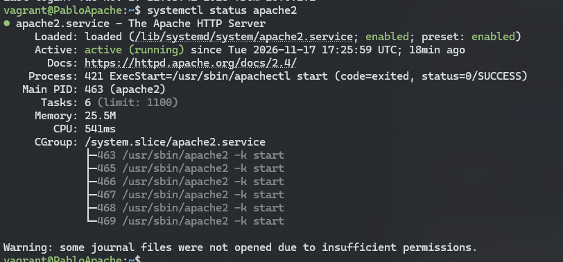
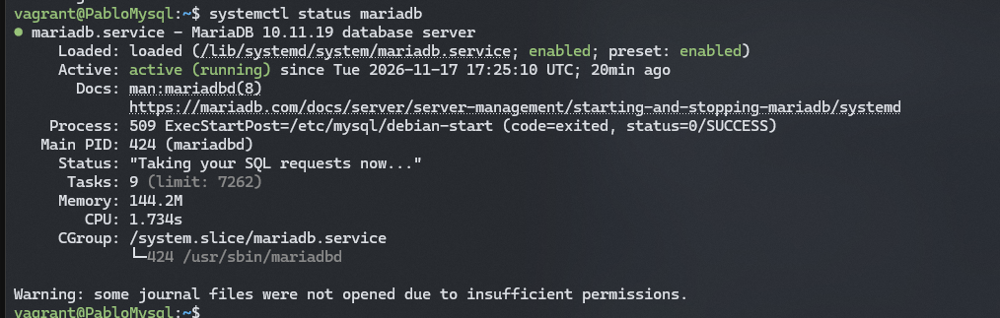

# Infraestructura LAMP en dos niveles con Vagrant

**Autor:** Pablo Alcón Hernández
**Módulo:** Implantación de Aplicaciones Web
**Curso:** 2026/2027

## 1. Explicación de la Práctica

Esta práctica consiste en el despliegue de una arquitectura web en dos niveles utilizando la herramienta de virtualización Vagrant con boxes de Debian 12. La infraestructura consta de dos máquinas virtuales:

1. **Servidor Web (Frontend):** Máquina llamada `PabloApache`. Implementa Apache y PHP. Tiene acceso a Internet a través de NAT y es accesible desde el equipo anfitrión mediante el reenvío de puertos (Port Forwarding), redirigiendo el puerto 8080 del host al 80 de la máquina.
2. **Servidor de Base de Datos (Backend):** Máquina llamada `PabloMysql`. Implementa MariaDB. Está totalmente aislada, por lo que **no tiene acceso a Internet**. Su única comunicación es a través de una red privada interna que la conecta en exclusiva con el servidor web.

Sobre esta infraestructura se despliega una aplicación PHP de gestión de usuarios que realiza consultas a la base de datos remota.

## 2. Fichero de Configuración (Vagrantfile)

El siguiente archivo define la infraestructura, las redes, los nombres de las máquinas y las llamadas a los scripts de aprovisionamiento.

```ruby
# -*- mode: ruby -*-
# vi: set ft=ruby :

Vagrant.configure("2") do |config|

  config.vm.box = "debian/bookworm64"
  config.vm.synced_folder ".", "/vagrant", disabled: true

  #  MÁQUINA 1
  config.vm.define "mysql" do |mysql|
    mysql.vm.hostname = "PabloMysql"

    mysql.vm.network "private_network",
      ip: "192.168.56.11",
      virtualbox__intnet: "red_interna"

    mysql.vm.provider "virtualbox" do |vb|
      vb.name = "PabloMysql"
      vb.memory = 1024
      vb.cpus = 1
    end

    # Se llama directamente al script refactorizado que incluye todo el proceso
    mysql.vm.provision "shell", path: "provision_mysql.sh"
  end

  #  MÁQUINA 2
  config.vm.define "apache" do |apache|
    apache.vm.hostname = "PabloApache"

    apache.vm.network "private_network",
      ip: "192.168.56.10",
      virtualbox__intnet: "red_interna"

    apache.vm.network "forwarded_port",
      guest: 80,
      host: 8080,
      host_ip: "127.0.0.1"

    apache.vm.provider "virtualbox" do |vb|
      vb.name = "PabloApache"
      vb.memory = 1024
      vb.cpus = 1
    end

    # se pilla el script de aprovisionamiento de apache y se ejecuta
    apache.vm.provision "shell", path: "provision_apache.sh"
  end

end
```

## 3. Scripts de Aprovisionamiento y Explicación de Órdenes

A continuación se incluyen los scripts de Bash utilizados para aprovisionar las máquinas automáticamente durante el `vagrant up`, junto con la explicación detallada de cada instrucción.

### 3.1. Servidor Web (`provision_apache.sh`)

```bash
#!/bin/bash

# --- VARIABLES DE ENTORNO ---
REPO_URL="https://github.com/josejuansanchez/iaw-practica-lamp.git"
WEB_DIR="/var/www/html"
TEMP_DIR="/tmp/app_temp"
DB_HOST="192.168.56.11"
DB_NAME="lamp_db"
DB_USER="lamp_user"
DB_PASS="lamp_password"
```

- **Definición de variables:** Se establecen rutas, credenciales y direcciones IP en variables para que el código sea más limpio, fácil de mantener y reutilizable.

```bash
# 1. Actualizar e instalar dependencias (todo en un paso)
apt-get update -y
apt-get install -y apache2 php libapache2-mod-php php-mysql git
```

- `apt-get update -y`: Actualiza el listado de paquetes disponibles en los repositorios de Debian.
- `apt-get install -y ...`: Instala el servidor web Apache, el lenguaje PHP, los módulos que permiten la comunicación entre PHP y MySQL, y el control de versiones Git. El parámetro `y` acepta automáticamente la instalación.

```bash
# 2. Descargar la aplicación en una carpeta temporal
rm -rf $TEMP_DIR
git clone $REPO_URL $TEMP_DIR
```

- `rm -rf`: Elimina cualquier rastro previo de la carpeta temporal para evitar conflictos.
- `git clone`: Descarga el código de la aplicación desde GitHub y lo guarda en el directorio temporal especificado.

```bash
# 3. Mover la aplicación a la carpeta web y limpiar
rm -rf ${WEB_DIR}/*
mv ${TEMP_DIR}/src/* $WEB_DIR/
```

- `rm -rf`: Vacía el directorio web público por defecto (`/var/www/html/`) eliminando el archivo `index.html` de bienvenida.
- `mv`: Mueve todos los archivos del código fuente de la aplicación al directorio público de Apache.

```bash
# 4. Configurar la conexión a la base de datos
cd $WEB_DIR
sed -i "s/'localhost'/'${DB_HOST}'/" config.php
sed -i "s/'database_name_here'/'${DB_NAME}'/" config.php
sed -i "s/'username_here'/'${DB_USER}'/" config.php
sed -i "s/'password_here'/'${DB_PASS}'/" config.php
```

- `cd`: Cambia el directorio actual al directorio web.
- `sed -i` : Comando de sustitución que busca las credenciales por defecto (como 'localhost') en el archivo `config.php` y las reemplaza por las variables correctas de nuestra infraestructura para hacer que la aplicación sea funcional.

```bash
# 5. Aplicar permisos y reiniciar servicios
chown -R www-data:www-data $WEB_DIR
rm -rf $TEMP_DIR
systemctl restart apache2
```

- `chown -R`: Cambia recursivamente el propietario y grupo de los archivos web al usuario `www-data`  para evitar errores de permisos.
- `rm -rf`: Borra la carpeta temporal para ahorrar espacio.
- `systemctl restart`: Reinicia el servicio de Apache para aplicar cualquier cambio de configuración pendiente.

### 3.2. Servidor de Base de Datos (`provision_mysql.sh`)

```bash
#!/bin/bash

# --- VARIABLES DE ENTORNO ---
REPO_URL="https://github.com/josejuansanchez/iaw-practica-lamp.git"
TEMP_DIR="/tmp/app_temp"
WEB_IP="192.168.56.10"
DB_NAME="lamp_db"
DB_USER="lamp_user"
DB_PASS="lamp_password"
```

- **Definición de variables:** Igual que en el script anterior, junta IPs, rutas y credenciales.

```bash
# 1. Actualizar e instalar servicios
apt-get update -y
apt-get install -y mariadb-server git
```

- `apt-get update -y`: Actualiza el listado de paquetes.
- `apt-get install -y ...`: Instala el servidor de base de datos relacional MariaDB y la herramienta Git.

```bash
# 2. Exponer MariaDB modificando directamente la directiva bind-address
sed -i 's/^bind-address.*/bind-address = 0.0.0.0/' /etc/mysql/mariadb.conf.d/50-server.cnf
systemctl restart mariadb
```

- `sed -i ...`: Modifica el archivo de configuración de MariaDB buscando la directiva `bind-address` (que por defecto viene en `127.0.0.1`) y la cambia a `0.0.0.0` para que el servidor acepte conexiones desde otras máquinas de la red privada (como el servidor Apache).
- `systemctl restart mariadb`: Aplica el cambio reiniciando el servicio.

```bash
# 3. Descargar el repositorio para obtener el script de la base de datos
rm -rf $TEMP_DIR
git clone $REPO_URL $TEMP_DIR
```

- Descarga el código de la aplicación de nuevo en esta máquina, ya que necesitamos extraer el archivo `.sql` que contiene la estructura de las tablas.

```bash
# 4. Importar el esquema SQL
mysql -u root < ${TEMP_DIR}/db/database.sql
```

- `mysql -u root < ...`: Ejecuta el cliente de MariaDB inyectando el archivo `database.sql` descargado. Esto crea la base de datos y la tabla de usuarios.

```sql
# 5. Crear el usuario remoto y asignar privilegios (usando un bloque EOF)
mysql -u root <<EOF
DROP USER IF EXISTS '${DB_USER}'@'${WEB_IP}';
CREATE USER '${DB_USER}'@'${WEB_IP}' IDENTIFIED BY '${DB_PASS}';
GRANT ALL PRIVILEGES ON ${DB_NAME}.* TO '${DB_USER}'@'${WEB_IP}';
FLUSH PRIVILEGES;
EOF
```

- `mysql -u root <<EOF ... EOF`: Permite pasar un bloque entero de comandos SQL directamente al gestor:
    - `DROP USER`: Elimina al usuario si ya existiese.
    - `CREATE USER`: Crea un usuario con la contraseña indicada, pero restringido para que *solo* pueda conectarse si proviene de la IP `192.168.56.10` (el servidor web).
    - `GRANT ALL`: Le otorga permisos totales sobre la base de datos de la app.
    - `FLUSH PRIVILEGES`: Recarga la tabla de permisos de MariaDB.

```bash
# 6. Limpieza final
rm -rf $TEMP_DIR
```

- Elimina los archivos temporales de GitHub que ya no se necesitan.

```bash
# 7. Aislar la red de la máquina (limita la salida a Internet)
ip route del default
```

- `ip route del default`: Elimina la puerta de enlace predeterminada (Gateway) de la tabla de enrutamiento de la máquina virtual. Esto **corta por completo su salida y acceso a Internet**, cumpliendo así el requisito de seguridad exigido en la teoría. Su única conexión posible queda en la red interna (192.168.56.0).

## 4. Evidencias de Funcionamiento

A continuación se demuestra que los servidores están corriendo correctamente en cada máquina virtual utilizando sus hostnames correspondientes.

### 4.1. Servidor Apache (`PabloApache`)




### 4.2. Servidor de Base de Datos (`PabloMysql`)



